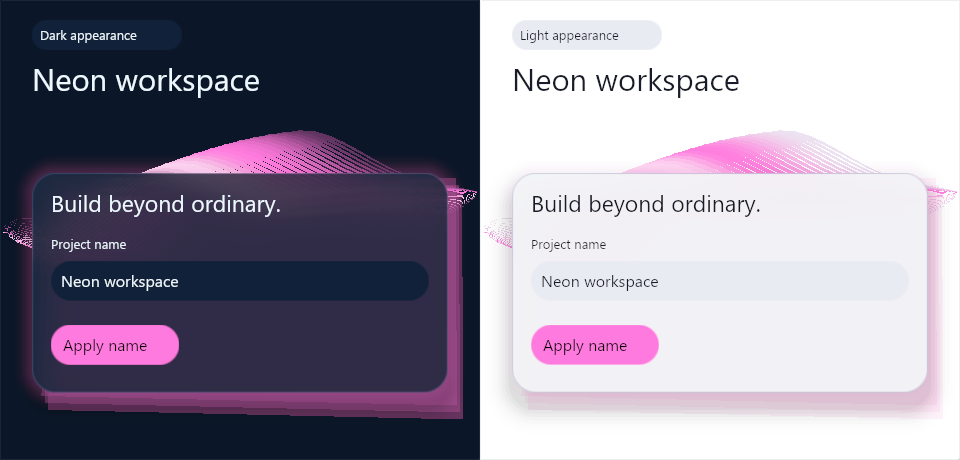
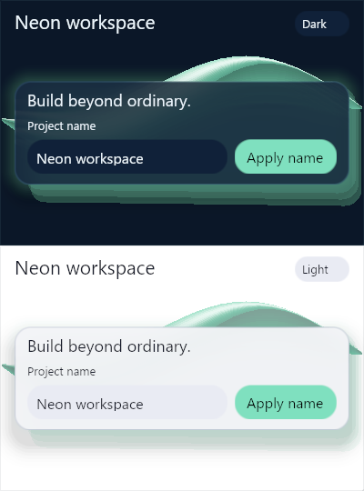
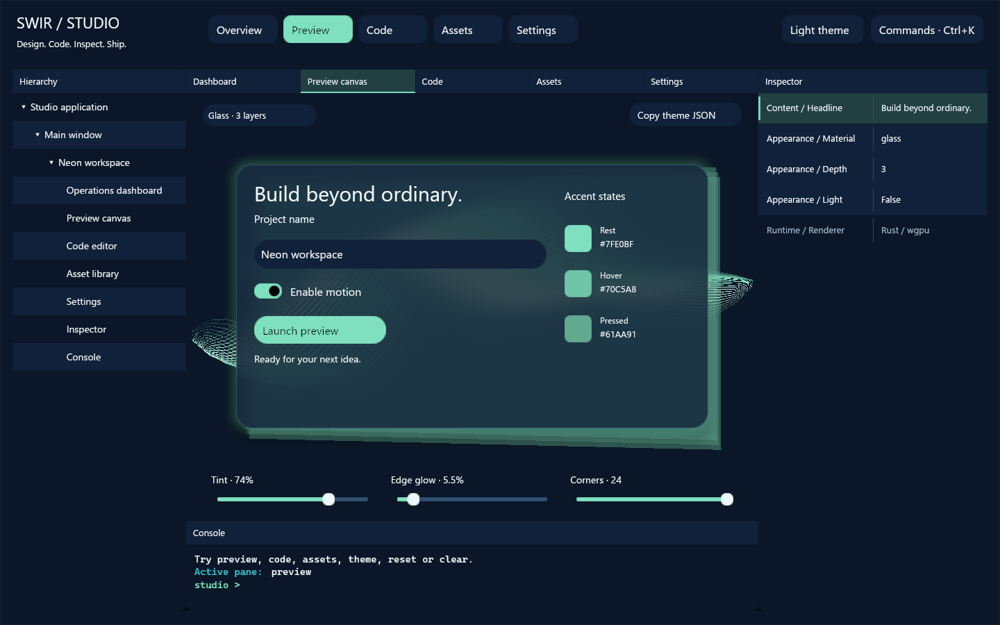
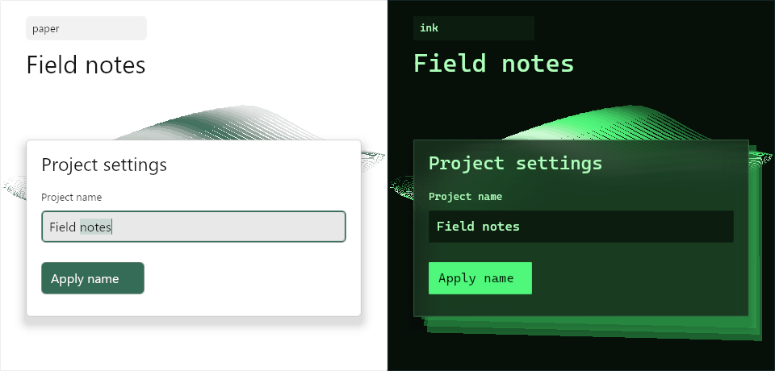

# Studio in SwirUI 0.2 development

From a Windows checkout of `development/0.2` with the native renderer installed,
run `python -m swirui studio`. In **Overview → Material library**, choose a
material, then select **Launch preview**.

The preview opens the same form in dark and light appearances. Both use the
themes exported by **Save theme…**, so you can inspect the finish, focus ring and
button states your app will inherit. Tab to a project name, type a new name
and press Enter or select **Apply name**. Both halves update together. Your
Studio project keeps its original name.

Leave the comparison open while you work in Studio. Changing the accent,
material, depth, tint, glow, corners or headline updates both panes together.
For example, choose **Rose** in **Settings → Signature color**, then move
**Corners** in the preview. Your sample text and its selection survive both
edits. Select **Launch preview** again when you want to restore the sample to
the current project name. Closing the comparison leaves Studio open.



The ribbon behind each card has two faces. A narrow highlight follows the
fold into a shaded reverse. To use it in your own window, add a `SilkRibbon`
to a themed panel before adding the controls you want in front. Changing the
panel's accent recolors the ribbon and reuses its existing geometry.

This 960 × 460 capture is a direct readback of the Windows wgpu frame on AMD
Radeon graphics with DX12. To reproduce it from the same checkout, run
`python tools/capture_studio.py --pane comparison --accent "#FF7ADE" --corner-radius 24 --output studio-comparison.png`.
The OS cursor is outside the captured frame.

Narrow the comparison to less than 640 logical pixels to see the first
appearance above the second. Both forms stay editable down to a 320 × 390
window. In a short pane the project field shares a row with **Apply name**.
Widen the window again to return to the side-by-side view. A field you
were editing keeps keyboard focus, its draft text and its selection.
The same layout works with saved packages opened by `preview-theme`.



To reproduce this Windows/wgpu capture without a cursor, run
`python tools/capture_studio.py --pane comparison --comparison-size 400 540 --accent "#7FE0BF" --corner-radius 18 --output studio-comparison-compact.png`.

The **Apply name** buttons center their captions using the width of the shaped
text. You can use the same alignment for buttons in your app.

```python
from swirui import Button, IconButton
from swirui.rendering import Rect

save = Button("Save project", bounds=Rect(24, 20, 176, 44), text_align="center")
favorite = IconButton("★", bounds=Rect(212, 20, 44, 44), accessible_name="Favorite")
```

Set `save.text_align` to `"left"`, `"center"` or `"right"` to position the
caption inside the button's padding. The default `"auto"` on regular buttons
uses the renderer's paragraph alignment. Icon buttons default to `"center"`.

## Frame images in your own app

Run `python examples/image_framing.py` from the checkout. The left pane shows
the whole source image. Drag **Horizontal position** under the square crop
or focus the slider and use the arrow keys to pan across the same source.


After registering a decoded image with your renderer, choose which edge a
card keeps when its aspect ratio changes.

```python
from swirui.rendering import Point, Rect
from swirui.widgets import Image, ImageFit

asset.register_frame(renderer, "cover")
cover = Image("cover", pixel_width=asset.width, pixel_height=asset.height,
              bounds=Rect(0, 0, 256, 256), fit=ImageFit.COVER,
              image_position=Point(1, 0.5))
root.add(cover)
cover.image_position = Point(0.25, 0.5)
```

The two coordinates run from 0 (left or top) to 1 (right or bottom).
Both default to 0.5. With `COVER` they control the crop. With `CONTAIN`
they position the whole image within the spare space. `NONE` aligns the
image at its intrinsic size and `FILL` spans the entire frame. Changing the
position reuses the existing GPU texture. The same property works on
`CameraView`, `VideoPlayer` and `Lottie`.

## Shape your controls

The **Corners** slider below the preview sets the radius of themed buttons,
inputs and material cards in logical pixels. Drag from 0 for square corners
to 24 for a rounded finish. Keep the mouse button down and move above or
below the track. Moving horizontally still adjusts the corners. On Windows
you can drag beyond the window edge and release there. Your app's `Slider`
and `RangeSlider` use the same gesture. A range drag keeps the handle you
started with, even when you move across the other handle.

With keyboard focus on the slider, the arrow keys
change the value by one. Home and End jump to the two extremes.

In the Inspector, set **Depth layers** to 6 to see the stack behind the card.
Click the value beside **Tilt X (°)**, press Delete to clear it, type `-24`
and press Enter. Set **Tilt Y (°)** to `32` the same way. X tilts the top
and bottom edges and Y tilts the sides. Each accepts whole degrees from
−35 to 35. The form stays in place while both appearances update.


To reproduce this cursor-free Windows/wgpu frame, run
`python tools/capture_studio.py --pane preview --width 1440 --height 900 --accent "#67DCCA" --corner-radius 18 --depth-layers 6 --layer-tilt -24 32 --output studio-tilt.png`.

**Save theme…** writes both angles to `surface_style.tilt_x` and
`surface_style.tilt_y` in each variant. A `ThemeSurface` in your Python app
uses those angles and the theme's corner radius when it draws the layers.
Set **Depth layers** to 0 to hide the stack and raise it again to reuse the
same angles.

Both exported appearances carry the same `control_radius`. In your app,
assign `ThemePackage.load("studio-theme.json").default` to the root panel's
`theme` after saving the JSON from Studio. Controls with a locally specified
radius keep their own shape.

Tab to **Enable motion** in the preview. A thin outline follows the switch
and a line in the theme's canvas color separates it from the track. This
keeps focus visible when the switch is already on. Your app's `Checkbox`,
`RadioButton` and `Switch` inherit the same treatment from their theme.
Press Space to activate the focused control, then Tab to move on.



To reproduce this cursor-free native capture, run
`python tools/capture_studio.py --pane preview --width 1440 --height 900 --accent "#7FE0BF" --corner-radius 24 --focus-motion --output studio-corners.png`.

## Try a saved theme

In the preview toolbar, select **Save theme…** and choose a folder and filename
in the Windows dialog. The file includes both appearances and opens in the
appearance you selected in Studio. **Copy theme JSON** puts the same package
on the clipboard.

From the folder containing your saved file, run
`python -m swirui preview-theme studio-theme.json` using your development
environment. Substitute your filename if you renamed the package.
The window opens with the package default first, followed by the
first other variant in file order. A single variant fills the window. Try
typing a new project name or tabbing between controls. Sample edits stay in
the preview window.

The same command works with packages created in Python. This example pairs a
light surface with a green glass variant and its own typeface.

```python
from dataclasses import replace
from swirui import MATRIX, MINIMAL, SurfaceStyle, ThemePackage

paper = MINIMAL.with_accent("#346C57")
ink = replace(MATRIX, surface_style=SurfaceStyle(kind="glass", depth_layers=3, elevation=10))
ThemePackage("Field notes", {"paper": paper, "ink": ink}, "paper").save("field-notes.json")
```

```sh
python -m swirui preview-theme field-notes.json
python -m swirui preview-theme field-notes.json --list-variants
python -m swirui preview-theme field-notes.json --variant ink
python -m swirui preview-theme field-notes.json --variant ink --variant paper
```

Listing the variant keys works without a graphics backend.
The first command opens the window below. In the paper variant, drag across
the word **notes** in the project name field. The highlight follows the
rendered letters. Release the mouse to keep the selection, or Shift+click to
extend it. The same gesture works in your own `Input` and `TextArea` controls,
including read-only fields. You can drag across lines in a `TextArea`.

To select **notes** with the keyboard, focus the project name, press Ctrl+End,
then Ctrl+Shift+Left. Type a replacement to change just that word. Ctrl+Left
and Ctrl+Right move between the starts of words and punctuation groups.
Letters, digits and underscores stay together in names such as `theme_02`.
In a `TextArea` or `CodeEditor`, Ctrl+Home and Ctrl+End jump to the start
and end of the document. Hold Shift with either shortcut to extend a selection.

To remove a word, use Ctrl+Backspace or Ctrl+Delete. Try Ctrl+Delete at the
start of **Field notes** to remove **Field** and its following space. From the
end of the same name, Ctrl+Backspace removes **notes**. With text selected,
either shortcut deletes just the selection. In a multiline field the deleted
range can include a line break and indentation. In a `CodeEditor`, Ctrl+Z
restores the text and caret or selection in one step.


