# Studio in SwirUI 0.2 development

From a Windows checkout of `development/0.2` with the native renderer installed,
run `python -m swirui studio`. In **Overview → Material library**, choose a
material, then select **Launch preview**.

The preview opens the same form in dark and light appearances. Both use the
themes exported by **Save theme…**, so you can inspect the finish, focus ring and
button states your app will inherit. Tab to a project name, type a new name
and press Enter or select **Apply name**. Both halves update together. Your
Studio project keeps its original name.

Leave the comparison open while you work in Studio. Changing the accent,
material, depth, tint, glow, corners or headline updates both panes together.
For example, choose **Rose** in **Settings → Signature color**, then move
**Corners** in the preview. Your sample text and its selection survive both
edits. Select **Launch preview** again when you want to restore the sample to
the current project name. Closing the comparison leaves Studio open.


The ribbon behind each card has two faces. A narrow highlight follows the
fold into a shaded reverse. To use it in your own window, add a `SilkRibbon`
to a themed panel before adding the controls you want in front. Changing the
panel's accent recolors the ribbon and reuses its existing geometry.

This 960 × 460 capture is a direct readback of the Windows wgpu frame on AMD
Radeon graphics with DX12. To reproduce it from the same checkout, run
`python tools/capture_studio.py --pane comparison --accent "#FF7ADE" --corner-radius 24 --output studio-comparison.png`.
The OS cursor is outside the captured frame.

Narrow the comparison to less than 640 logical pixels to see the first
appearance above the second. Both forms stay editable down to a 320 × 390
window. In a short pane the project field shares a row with **Apply name**.
Widen the window again to return to the side-by-side view. A field you
were editing keeps keyboard focus, its draft text and its selection.
The same layout works with saved packages opened by `preview-theme`.


To reproduce this Windows/wgpu capture without a cursor, run
`python tools/capture_studio.py --pane comparison --comparison-size 400 540 --accent "#7FE0BF" --corner-radius 18 --output studio-comparison-compact.png`.

The **Apply name** buttons center their captions using the width of the shaped
text. You can use the same alignment for buttons in your app.

```python
from swirui import Button, IconButton
from swirui.rendering import Rect

save = Button("Save project", bounds=Rect(24, 20, 176, 44), text_align="center")
favorite = IconButton("★", bounds=Rect(212, 20, 44, 44), accessible_name="Favorite")
```

Set `save.text_align` to `"left"`, `"center"` or `"right"` to position the
caption inside the button's padding. The default `"auto"` on regular buttons
uses the renderer's paragraph alignment. Icon buttons default to `"center"`.

## Frame images in your own app

Run `python examples/image_framing.py` from the checkout. The left pane shows
the whole source image. Drag **Horizontal position** under the square crop
or focus the slider and use the arrow keys to pan across the same source.

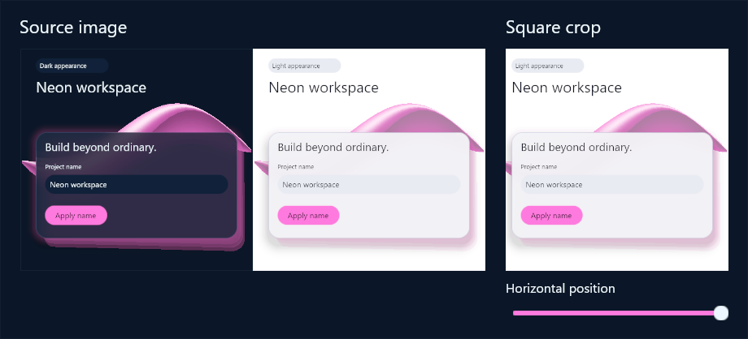

After registering a decoded image with your renderer, choose which edge a
card keeps when its aspect ratio changes.

```python
from swirui.rendering import Point, Rect
from swirui.widgets import Image, ImageFit

asset.register_frame(renderer, "cover")
cover = Image("cover", pixel_width=asset.width, pixel_height=asset.height,
              bounds=Rect(0, 0, 256, 256), fit=ImageFit.COVER,
              image_position=Point(1, 0.5))
root.add(cover)
cover.image_position = Point(0.25, 0.5)
```

The two coordinates run from 0 (left or top) to 1 (right or bottom).
Both default to 0.5. With `COVER` they control the crop. With `CONTAIN`
they position the whole image within the spare space. `NONE` aligns the
image at its intrinsic size and `FILL` spans the entire frame. Changing the
position reuses the existing GPU texture. The same property works on
`CameraView`, `VideoPlayer` and `Lottie`.

## Shape your controls

The **Corners** slider below the preview sets the radius of themed buttons,
inputs and material cards in logical pixels. Drag from 0 for square corners
to 24 for a rounded finish. Keep the mouse button down and move above or
below the track. Moving horizontally still adjusts the corners. On Windows
you can drag beyond the window edge and release there. Your app's `Slider`
and `RangeSlider` use the same gesture. A range drag keeps the handle you
started with, even when you move across the other handle.

With keyboard focus on the slider, the arrow keys
change the value by one. Home and End jump to the two extremes.

In the Inspector, set **Depth layers** to 6 to see the stack behind the card.
Click the value beside **Tilt X (°)**, press Delete to clear it, type `-24`
and press Enter. Set **Tilt Y (°)** to `32` the same way. X tilts the top
and bottom edges and Y tilts the sides. Each accepts whole degrees from
−35 to 35. The form stays in place while both appearances update.

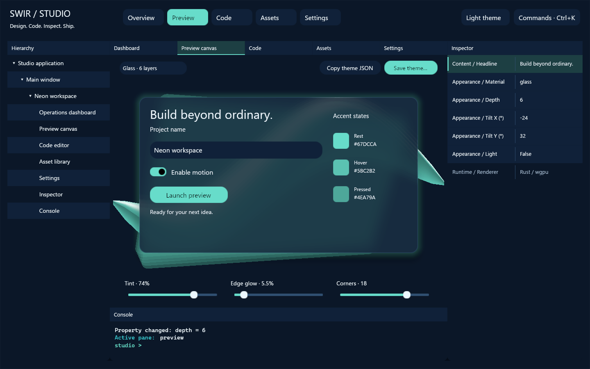

To reproduce this cursor-free Windows/wgpu frame, run
`python tools/capture_studio.py --pane preview --width 1440 --height 900 --accent "#67DCCA" --corner-radius 18 --depth-layers 6 --layer-tilt -24 32 --output studio-tilt.png`.

**Save theme…** writes both angles to `surface_style.tilt_x` and
`surface_style.tilt_y` in each variant. A `ThemeSurface` in your Python app
uses those angles and the theme's corner radius when it draws the layers.
Set **Depth layers** to 0 to hide the stack and raise it again to reuse the
same angles.

Both exported appearances carry the same `control_radius`. In your app,
assign `ThemePackage.load("studio-theme.json").default` to the root panel's
`theme` after saving the JSON from Studio. Controls with a locally specified
radius keep their own shape.

Tab to **Enable motion** in the preview. A thin outline follows the switch
and a line in the theme's canvas color separates it from the track. This
keeps focus visible when the switch is already on. Your app's `Checkbox`,
`RadioButton` and `Switch` inherit the same treatment from their theme.
Press Space to activate the focused control, then Tab to move on.


To reproduce this cursor-free native capture, run
`python tools/capture_studio.py --pane preview --width 1440 --height 900 --accent "#7FE0BF" --corner-radius 24 --focus-motion --output studio-corners.png`.

### Tilt a material with the pointer

In Studio, choose **Glass**, set **Depth layers** to 6 in the Inspector and
leave **Enable motion** on. Move the pointer from the top left to the bottom
right of the card. Watch the layers below the bottom edge and along the right
side. The diagonal highlight follows the rounded face. You can keep typing in
the project field as the layers move.

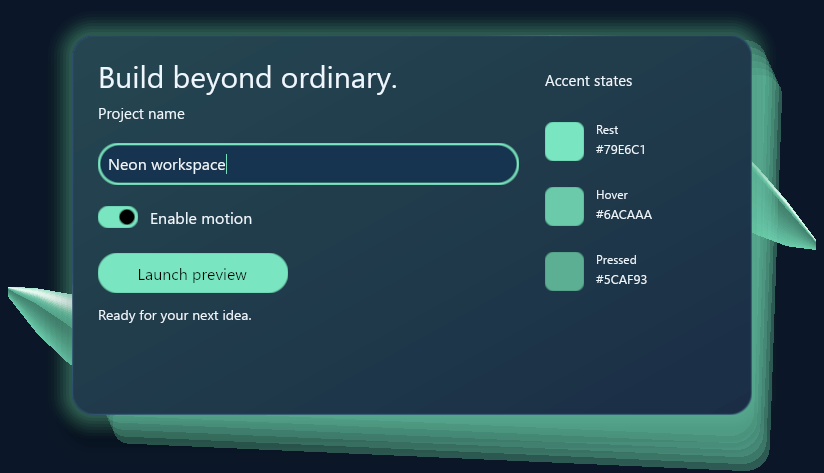

These 24 cursor-free frames show a crop of the native Studio preview on
Windows with AMD Radeon graphics and DX12. In your own app, bind the effect
after mounting a card whose material has depth layers.

```python
from swirui import AnimationController, SurfaceInteraction

animations = AnimationController(app, window)
interaction = SurfaceInteraction(animations, card, tilt_degrees=14)
```

`tilt_degrees` accepts 0 to 35 and defaults to 0. The center of the card uses
the angles in its `SurfaceStyle`. Moving toward an edge adds tilt along that
axis, up to a total of 35 degrees in either direction. Leaving the card brings
the layers back to their authored angles. Keyboard focus still highlights
the card, and a theme with `reduced_motion=True` keeps the layers at rest.

### Leave the window with the keyboard selection intact

Run `python examples/core_gallery.py` on Windows. Select a word in the text
field, then hover over **Focus for help**. When “Your work stays right here.”
appears, move the pointer straight onto the title bar. The tooltip closes and
the word stays selected. Move back onto the button to show the tip again.

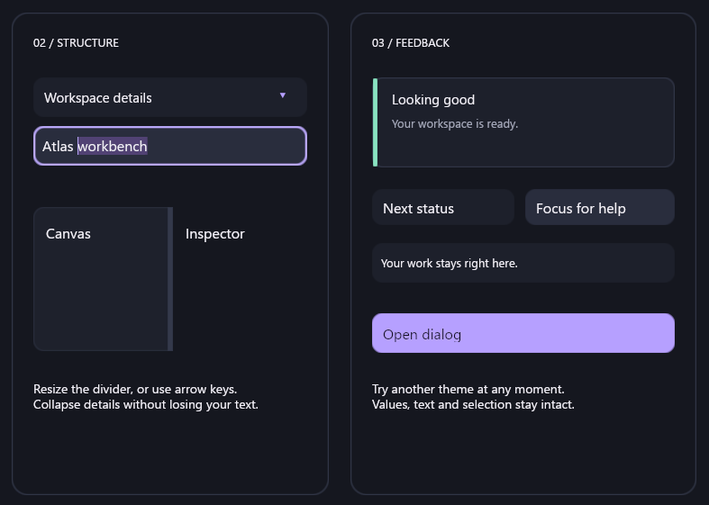

The two frames come from the Windows DX12 renderer and contain no cursor.
In your own window, the hovered control receives `pointer_leave`. Use
`window.on("pointer_exit", callback)` to react when the pointer leaves the
client area. The exit event carries no coordinates. A control with pointer
capture continues receiving drag events through button release.

## Edit a field inside an expander

Run `python examples/core_gallery.py` and click the text field under
**Workspace details**. Press End and type ` and drafts`, including the space.
Left and Right move the caret while the section stays open. Click the header
to collapse it, then press Right on that header to see your edited text again.

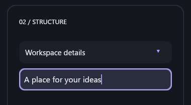

In your app, use an `Input`, a button or another `Expander` as section
content. Space activates a focused button. When the header itself has focus,
Space or Enter toggles the section, Left collapses it, and Right opens it.

## Edit text in a split pane

Run `python examples/core_split_view_demo.py`. In the right pane, drag
across `main` in `main.py` and type `draft`. Left and Right now move the
caret within `draft.py`. Click the divider, press Right three times to widen
the project pane, then select `draft` at its new position.

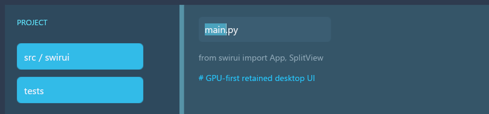

Place controls relative to the top-left corner of their pane. A nested
`SplitView` uses the same convention. A control that captures the pointer
continues to receive positions relative to its own pane when the pointer
crosses the divider. In a routed handler, `event.data["window_event"]`
still gives you the original logical window coordinates.

## Edit a range with the keyboard

Run `python examples/range_progress_demo.py` and press Tab to focus the
progress slider. Press Tab again for the lower limit of **Allowed range** and
once more for the upper limit. Press Left to move the upper limit from 80%
to 75%. Tab continues to the next control, and Shift+Tab retraces the stops.
The same sequence works inside a modal dialog.

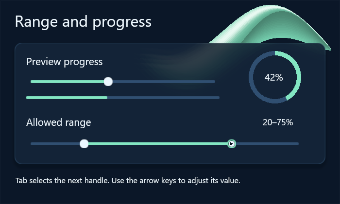

The arrow inside the focused handle points left for the lower limit and right
for the upper limit, including when both have the same value. Changing focus
preserves both numbers. The `changed` event fires when a value changes.
In the accessibility tree, each limit exposes its current value, allowed bounds
and focus state.

### Reach the last value on a stepped slider

Run `python examples/range_progress_demo.py --step 9`. Press Tab to focus the
progress slider, then End to reach 100%. Press Left twice to visit 99% and
90%. Press Right twice to walk back to 100%. Page Up and Page Down move ten
stops at a time, so Page Down from 100% lands on 18%.

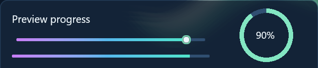

`Slider` and both handles of `RangeSlider` include the minimum and maximum
even when the final step is shorter. This works with fractional steps and
negative minima. Dragging or assigning a value in Python selects the nearest
stop. For this scale, 99.4 selects 99 and 99.6 selects 100.

### Reopen a collapsed range by dragging

Drag either handle until the two values meet, then release. Grab the shared
handle anywhere across its face. Drag left to lower the start of the range or
right to raise the end. The first movement that changes the stepped value
selects the handle for the rest of the drag. If you reverse past the other
handle, the two meet again. Release to choose a new direction.

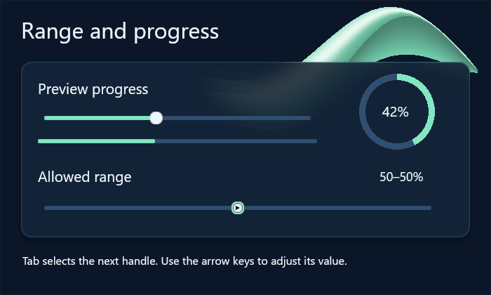

These 33 frames come from the same 700 × 420 Windows/wgpu demo window.

### Color a selected range

Use one `LinearGradient` for a slider, a range selector and a progress bar
when the same color should mean the same percentage across controls.
The two handles reveal the colors between their values. In the recording,
the selection narrows from 20–80% to 40–60%. The midpoint keeps its blue.

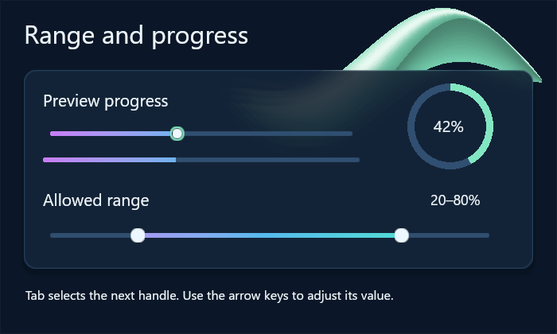

```python
from swirui import RangeSlider
from swirui.rendering import Color, LinearGradient, Rect

scale = LinearGradient.two_color(Color.from_hex("#9234ED"), Color.from_hex("#14D789"))
exposure = RangeSlider(bounds=Rect(24, 60, 360, 44), lower_value=20, upper_value=80,
                       fill_gradient=scale, accessible_name="Exposure range")
```

Assign a new gradient to `exposure.fill_gradient` to update it live, or assign
`None` to use the current theme accent. Disabled controls use the theme's
disabled color. To reproduce the four frames in the Windows demo, press Tab,
Page Up three times, Tab, Right four times, Tab, then Left four times.

## Give a progress bar a color scale

In `python examples/core_gallery.py`, focus the slider beneath **Progress,
with purpose**. Press Home, then Page Up to advance ten percentage points
at a time. The bar reveals lilac first, then blue and mint. At 80%, the
first half still has the colors you saw at 50%.

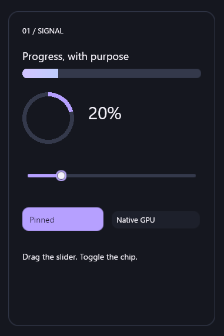

These four cursor-free frames come from the Windows DX12 renderer. To give
your own bar a two-color scale, pass a `LinearGradient` when you create it.

```python
from swirui import ProgressBar
from swirui.rendering import Color, LinearGradient, Rect

progress = ProgressBar(
    bounds=Rect(24, 60, 300, 16),
    value=50,
    fill_gradient=LinearGradient.two_color(
        Color.from_hex("#A38BFF"), Color.from_hex("#82E7B8")
    ),
)
```

Stops are positioned across the full track, from `minimum` to `maximum`.
Use a multi-stop `LinearGradient` for intermediate colors, or assign a new
one to `progress.fill_gradient` while the app is running. Assign `None` to
use the current theme accent again. A disabled bar uses the theme's disabled color.

### Show the last percent on a ring

In the same gallery, focus the slider and press End, then Left. At 99% a
gap is still visible just before twelve o’clock. Press Right to close it.
Press Home, then Right to see the first 1% appear on the other side.

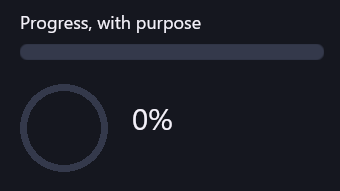

In your own app, set `ProgressRing.value` directly. For example,
`ProgressRing(bounds=Rect(24, 24, 120, 120), value=99, segments=8)`
has a faceted outline and a one-percent gap. Choose more segments for a
rounder outline. Values between vertices advance the arc in either case.
Custom `minimum` and `maximum` values map onto the same full turn.
The recording shows the default 48 segments on Windows/DX12.

## Animate a theme switch

To try an animated theme switch in a running app, launch
`python examples/appearance_gallery.py`. Select **Dark**, pause for a few
seconds, then select **Light**. Watch the background and buttons change
together. Look just below the workspace card as its four glass backplates
tilt and spread apart and the shadow deepens. The field and button stay in
place. The card on the right keeps its own dark theme. You can type a
workspace name before switching and continue editing it afterward.

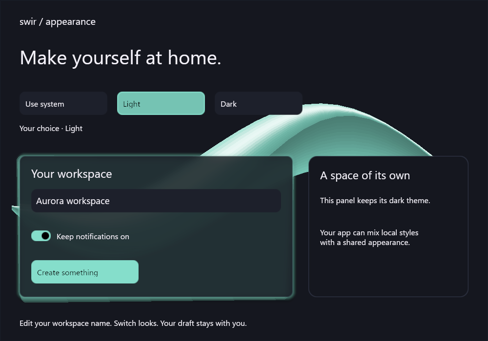

The animation shows nine cursor-free frames read from the Windows/wgpu
renderer, sampled on a controlled clock and played at quarter speed.

In your app, pass the window's `AnimationController` to `ThemeController`
to enable these transitions. Each new animation starts timing when you play
it, including when another animation is already running. A theme with
`reduced_motion=True` switches immediately.

```python
from swirui import AnimationController, ThemeController, ThemeMode

animations = AnimationController(app, window)
appearance = ThemeController(window, mode=ThemeMode.DARK, animations=animations)

def use_light(_event):
    appearance.mode = ThemeMode.LIGHT

light_button.on("click", use_light)
```

## Try a saved theme

In the preview toolbar, select **Save theme…** and choose a folder and filename
in the Windows dialog. The file includes both appearances and opens in the
appearance you selected in Studio. **Copy theme JSON** puts the same package
on the clipboard.

From the folder containing your saved file, run
`python -m swirui preview-theme studio-theme.json` using your development
environment. Substitute your filename if you renamed the package.
The window opens with the package default first, followed by the
first other variant in file order. A single variant fills the window. Try
typing a new project name or tabbing between controls. Sample edits stay in
the preview window.

When a package has additional variants, the name above each form is a button.
Select it to search the package. Type part of a variant key, then press Enter
or click a result. The other pane keeps its appearance, and both fields keep
their drafts and selections. Escape returns to the variant button. To try this
with the bundled material library, run the following from the checkout.

```sh
python -m swirui preview-theme examples/themes/ocean-studio.swirui-theme.json --variant glass
```

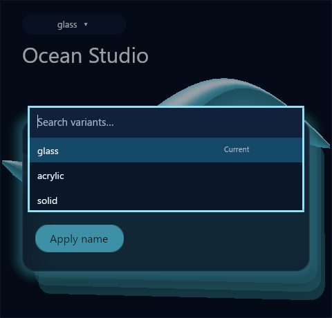

The same command works with packages created in Python. This example pairs a
light surface with a green glass variant and its own typeface.

```python
from dataclasses import replace
from swirui import MATRIX, MINIMAL, SurfaceStyle, ThemePackage

paper = MINIMAL.with_accent("#346C57")
ink = replace(MATRIX, surface_style=SurfaceStyle(kind="glass", depth_layers=3, elevation=10))
ThemePackage("Field notes", {"paper": paper, "ink": ink}, "paper").save("field-notes.json")
```

```sh
python -m swirui preview-theme field-notes.json
python -m swirui preview-theme field-notes.json --list-variants
python -m swirui preview-theme field-notes.json --variant ink
python -m swirui preview-theme field-notes.json --variant ink --variant paper
```

Listing the variant keys works without a graphics backend.
The first command opens the window below. In the paper variant, drag across
the word **notes** in the project name field. The highlight follows the
rendered letters. Release the mouse to keep the selection, or Shift+click to
extend it. The same gesture works in your own `Input` and `TextArea` controls,
including read-only fields. You can drag across lines in a `TextArea`.

To select **notes** with the keyboard, focus the project name, press Ctrl+End,
then Ctrl+Shift+Left. Type a replacement to change just that word. Ctrl+Left
and Ctrl+Right move between the starts of words and punctuation groups.
Letters, digits and underscores stay together in names such as `theme_02`.
In a `TextArea` or `CodeEditor`, Ctrl+Home and Ctrl+End jump to the start
and end of the document. Hold Shift with either shortcut to extend a selection.

To remove a word, use Ctrl+Backspace or Ctrl+Delete. Try Ctrl+Delete at the
start of **Field notes** to remove **Field** and its following space. From the
end of the same name, Ctrl+Backspace removes **notes**. With text selected,
either shortcut deletes just the selection. In a multiline field the deleted
range can include a line break and indentation. In a `CodeEditor`, Ctrl+Z
restores the text and caret or selection in one step.


### Reload your theme while editing

Keep the preview window open. Save another version of the same JSON file
from Studio, your editor or `ThemePackage.save()`, then press **F5** in the
preview. Both panes pick up their saved colors, fonts, corners and materials.
The form you are editing keeps its draft, keyboard focus and text selection.

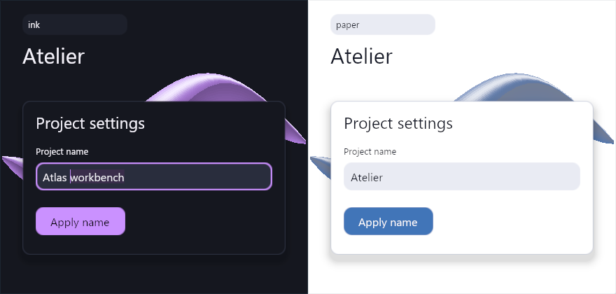

The two frames show the same Windows/wgpu window. The refreshed package
changes the accents to mint and terracotta and adds five tilted glass layers.
The word **workbench** stays selected.

The preview keeps each visible variant that still exists. If one is removed,
its pane uses the package default or the next available variant. A package
with a single variant fills the window. A preview opened with one explicit
`--variant` stays in one pane even if the file gains more variants.

If a save is incomplete or the file is missing, the last valid preview stays
on screen. The title shows **F5 to retry** and the terminal shows the reason.
Save the corrected file and press **F5** again.
